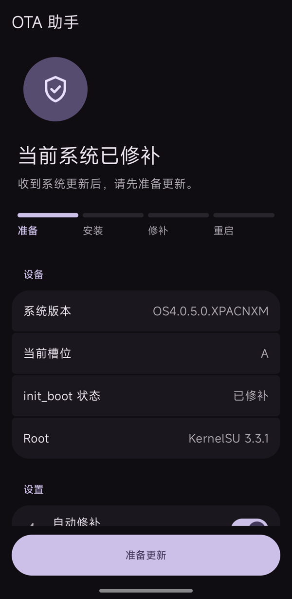
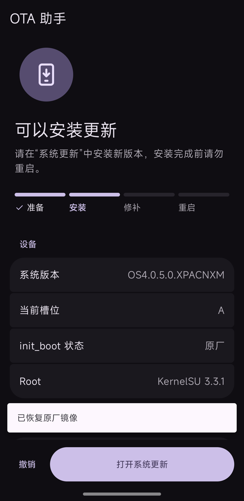
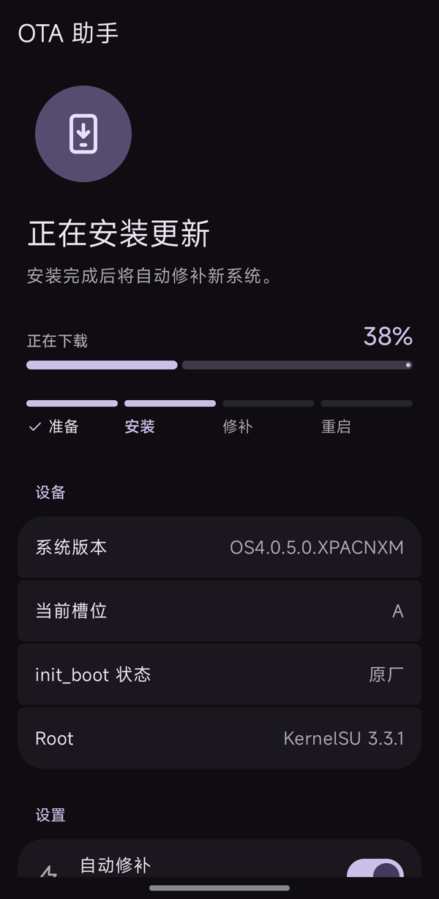
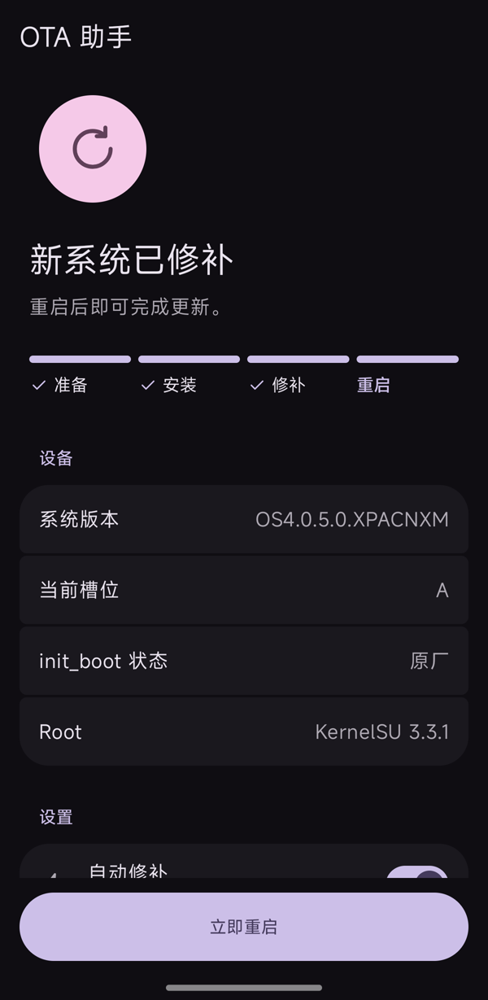

# OTA 助手

在 KernelSU（LKM 模式）设备上安装系统更新并保留 Root。

<p>
  
  
  
  
</p>

## 它做了什么

手动操作通常需要以下几步：

1. 刷回原厂 init_boot
2. 安装更新
3. 备份新系统的原厂镜像
4. 修补
5. 刷入
6. 重启

用 OTA 助手只需要三步：

1. 点 **准备更新**
2. 在系统更新中安装新版本，安装完成后**不要重启**
3. 点 **立即重启**（新系统会自动修补）

## 要求

- Android 14 及以上的 A/B（含虚拟 A/B）分区设备
- KernelSU，LKM 模式
- 已在 KernelSU 中为 OTA 助手授予 Root 权限

不支持 Magisk，也不支持内置于内核的 KernelSU。

## 使用

1. 从 [Releases](../../releases) 下载并安装 APK，然后在 KernelSU › 超级用户 中授权。
2. 收到系统更新后，打开 OTA 助手，点 **准备更新**。当前系统会恢复为原厂启动镜像，重启前 Root 仍然可用。
3. 点 **打开系统更新**，正常下载并安装。安装期间应用会在通知栏显示进度。
4. 安装完成后，应用会自动修补新系统。关闭了自动修补的话，点 **修补新系统**。
5. 点 **立即重启**。

如果不打算更新了，在第 3 步之前点 **撤销**，当前系统会重新修补。

打开系统更新的方式：
- 小米、Redmi、POCO：打开 HyperOS 系统更新。
- 其他品牌：打开 设置 › 系统更新。

## 安全措施

- 刷回原厂镜像前，先用 KernelSU 记录的 SHA-1 校验备份。
- 每次刷写前都先备份将被覆盖的镜像。
- 每次刷写后都校验整个分区。
- 任何一步校验失败，后续刷写都会停止，界面会说明此时能否重启。
- 只有系统更新已安装并等待重启时，才会修补另一个槽位。

## 备份

默认位置：`/sdcard/Download/advanced/init_boot/`，保留最近 3 个版本。

```
init_boot/
├── <版本号>/
│   ├── init_boot_stock.img   原厂镜像
│   └── init_boot_ksu.img     已修补镜像
└── pending/                  已安装、尚未重启进入的新版本
```

## 出现意外时

| 情况 | 处理 |
| --- | --- |
| 准备更新后未安装更新就重启，Root 丢失 | 在 fastboot 模式下刷入对应版本的 `init_boot_ksu.img`：<br>`fastboot flash init_boot init_boot_ksu.img` |
| 新系统启动后没有 Root | 刷入 `pending/` 或新版本目录中的 `init_boot_ksu.img`。 |
| 提示"操作未完成" | 按提示判断能否重启，并在 **日志** 中查看详情。 |

## 构建

```sh
./gradlew assembleRelease
```

需要 JDK 21 和 Android SDK 37。

## 许可

[MIT](LICENSE)
